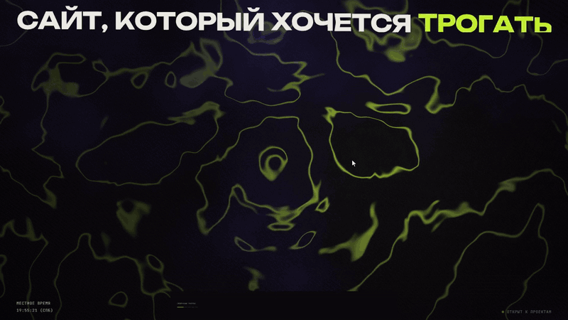

<div align="center">

# Сайт, который хочется&nbsp;<code>трогать</code>

**Портфолио fullstack-разработчика, где код, движение и графика работают как одно целое.**<br>
Живой шейдер вместо фона, 3D-карусель вместо списка, лампа вместо кнопки «Связаться».

[](https://astro.build)
[](https://threejs.org)
[](https://gsap.com)
[](https://www.typescriptlang.org)
[](references/hero.frag)

[**▶ Видео-тур**](docs/tour.mp4) &nbsp;·&nbsp; [**Как устроено**](#под-капотом) &nbsp;·&nbsp; [**Запустить**](#запуск-за-минуту) &nbsp;·&nbsp; [**Написать мне**](mailto:advasertip@gmail.com)

<br>

[](docs/tour.mp4)

<sub>Это превью. Полный тур на 50 секунд — по клику.</sub>

</div>

---

## Пять сцен, ноль скучных блоков

| | Сцена | Что происходит |
|:-:|---|---|
| **01** | **Первый экран** | Фон — не картинка и не видео, а фрагментный шейдер, который рисуется каждый кадр. Топографические линии текут, стягиваются к курсору и вспыхивают рядом с ним. Заголовок вылетает по буквам и подгоняется ровно под ширину экрана. В углу — живые часы. |
| **02** | **Избранные работы** | Блок работ ждёт миниатюрой внизу первого экрана, а при скролле разворачивается на весь экран. Дальше — 3D-карусель: карточки в перспективе, прилипание к каждому проекту, полоса прогресса, детали, которые сменяются строка за строкой. **Первая карточка свободна. Она для вас.** |
| **03** | **Бегущая строка** | Стек контурным шрифтом. Крутите колесо быстрее — строка разгоняется вместе с вами, отпустите — плавно вернётся к своему темпу. |
| **04** | **Обо мне** | Коротко и по делу: что я делаю и чем. |
| **05** | **Контакты** | «Давайте сделаем что-то **живое**» гудит, как старая лампа из кино, а «живое» щёлкает, гаснет и загорается новым цветом вместе со своей плашкой. |

И у каждого проекта — своя страница: задача, решение, результат, скриншоты. Название проекта **перелетает** со списка на страницу кейса через View Transitions.

---

## Под капотом

<details open>
<summary><b>🌀 Шейдер первого экрана</b> — 70 строк GLSL, ни одной текстуры</summary>
<br>

[`references/hero.frag`](references/hero.frag) рисует всё математикой прямо на видеокарте:

- **fbm-шум с доменным искажением** — шум, искривлённый другим шумом. Отсюда «жидкий» рельеф без повторяющегося узора;
- **изолинии** — `fract()` от высоты рельефа превращает его в топографическую карту лаймового цвета;
- **притяжение к курсору** — координаты рядом с мышью подтягиваются к ней, а линии там ярче. Позиция сглаживается `lerp`, поэтому движение мягкое, а без мыши точка притяжения плавает сама;
- **фиолетовое свечение, виньетка и зерно** — чтобы картинка не выглядела «компьютерной».

Шейдер живёт в React-острове на [React Three Fiber](https://r3f.docs.pmnd.rs): полноэкранная плоскость `2×2`, uniforms обновляются в `useFrame`, цвета берутся из тех же CSS-переменных, что и вёрстка.
</details>

<details>
<summary><b>🎞 Карусель работ</b> — скролл, который ощущается как перелистывание</summary>
<br>

- Одна секция закреплена (`position: sticky`), а прогресс скролла через **GSAP ScrollTrigger** превращается в номер проекта;
- карточки стоят в 3D-перспективе: соседние уходят вглубь и поворачиваются, в покое видна только текущая;
- **шаг между проектами считается от реальной высоты карточки**, поэтому соседние карточки никогда не наезжают друг на друга, а линии-разделители, список справа и карточки двигаются синхронно;
- прилипание (snap) срабатывает через 0.15 с после остановки: колесо мыши крутит рывками, и при меньшей задержке карусель дёргалась бы назад между щелчками.
</details>

<details>
<summary><b>💡 Мигающая лампа</b> — ноль JavaScript</summary>
<br>

Чистый CSS: `@keyframes` с `animation-timing-function: step-end`. Цвета не перетекают, а **щёлкают**, как реле, а между режимами лампа пару раз «спотыкается» в темноту. Две анимации разной длины (9 с и 14 с) не совпадают по фазе, поэтому мигание кажется случайным.
</details>

<details>
<summary><b>🗂 Кейсы</b> — один Markdown-файл на проект</summary>
<br>

Проекты лежат в **Astro Content Collections** со строгой схемой. Скриншоты подключаются через `image()`: Astro сам проверяет пути и при сборке нарезает картинки в `.webp` под разные экраны. Карточка может вести на страницу кейса или, как «Вы», прямо к контактам.
</details>

### Быстро и бережно

| | |
|---|---|
| ⚡ **Статика** | Сайт собирается в обычный HTML. JavaScript грузится только для интерактивных частей (Astro-острова) |
| 🎮 **Шейдер не жжёт батарею** | Рендерится, только пока виден на экране, плотность пикселей ограничена `1.5×` |
| 🫶 **Уважает настройки** | Включено «уменьшение движения» — анимации останавливаются, контент остаётся на месте |
| 📱 **Адаптивно** | От ультраширокого монитора до телефона |

---

## Запуск за минуту

Нужен **Node.js 22.22+**.

```bash
npm install
npm run dev       # → http://localhost:4321
```

```bash
npm run build     # статическая сборка в dist/
npm run preview   # посмотреть собранную версию
```

## Свой проект в карусели

Создайте файл в `src/content/projects/` — и карточка, страница кейса и пункт списка появятся сами:

```yaml
---
title: KORA
client: Концепт-проект
year: 2026
role: Fullstack — дизайн, фронтенд, бэкенд
stack: [Node.js, SQLite, Vanilla JS, PWA]
summary: Одна фраза, зачем смотреть этот проект.
colors: ['#e8a33d', '#1a1612']        # градиент, если нет скриншота
order: 1                              # место в карусели
cover: ../../assets/projects/kora/home.jpg      # скриншот на карточку и обложку
gallery:                                         # галерея на странице кейса
  - { src: ../../assets/projects/kora/catalog.jpg, alt: Каталог }
repo: https://github.com/quintgreg/sitecoffee   # кнопка «Код на GitHub»
url: https://example.com                        # кнопка «Открыть сайт»
---

## Задача
## Решение
## Результат
```

## Где что лежит

```text
src/
├── components/
│   ├── Hero.astro        первый экран и кинетика заголовка
│   ├── HeroScene.tsx     WebGL-остров с шейдером
│   ├── Works.astro       карусель работ
│   ├── Marquee.astro     бегущая строка
│   ├── About.astro       обо мне
│   └── Contact.astro     контакты и «лампа»
├── content/projects/     кейсы в Markdown
├── assets/projects/      скриншоты проектов
├── data/site.ts          имя, роль, город, почта, навыки — меняются здесь
├── pages/                главная и страницы кейсов
└── styles/global.css     цвета, шрифты, отступы
references/hero.frag      шейдер первого экрана
```

---

<div align="center">

### Есть идея?

Расскажите — она перестанет быть просто идеей.

**[advasertip@gmail.com](mailto:advasertip@gmail.com)**

</div>
